Trabalho com suporte de TI e estudo Engenharia de Software na PUC Minas. 
Gosto de resolver problemas e construir soluções que funcionam de verdade, principalmente no back-end.

## Sobre mim

## Tecnologias

## Projetos em destaque

<table>
  <tr>
    <td width="50%"></td>
    <td width="50%"></td>
  </tr>
  <tr>
    <td width="50%"></td>
    <td width="50%"></td>
  </tr>
</table>

## No GitHub

## Fliperama

